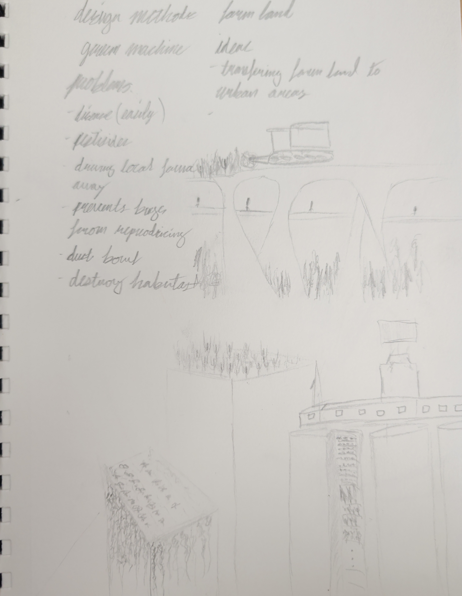
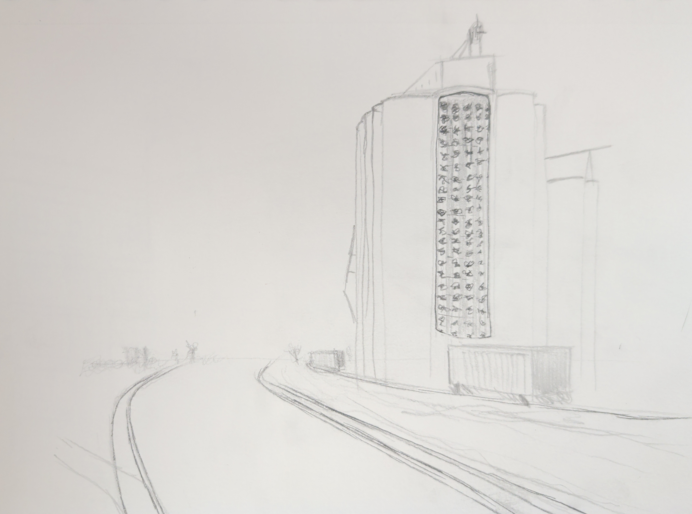
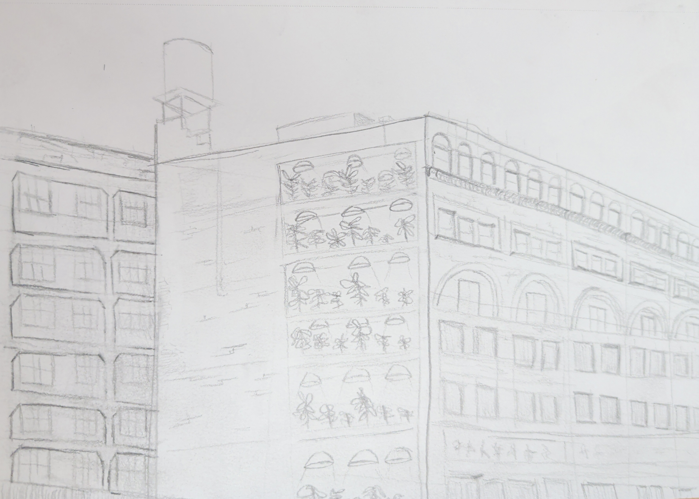

### Concern
The concern that hits close to home for me is the impact mass scale farming has one the environment. Most of my extended family do grain farming (usually for cow feed) and have hundreds of acres in farmland. Through the use of pestisides and clearning out the diversity in the flora in favor of a single crop, they have done a lot of damage to the area.
### Class Sketch

### Illustration

The main option I thought of was relocating the farms to abandoned or populated urban areas. The main sketches depict real abandoned areas in Kansas City. In Kansas City there are entire chunks of the city that were completely abandoned due to the nearby river flooding that area of the city (although that had happened over 80 years ago by this point), so repurposing those buildings/grain elevators would give you a lot of area for hydroponic style farming while upcycling the unused buildings.
