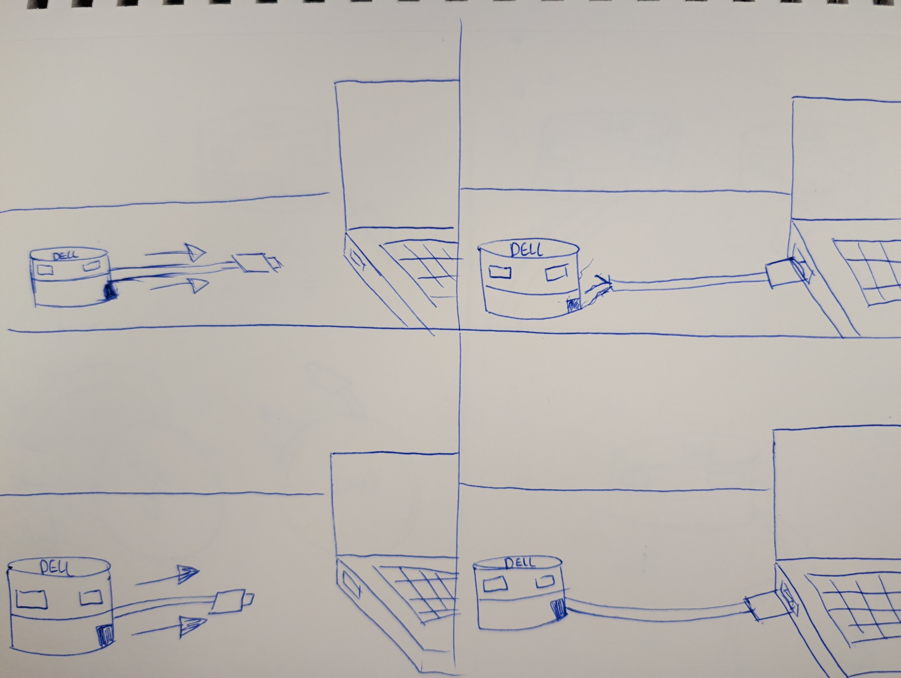
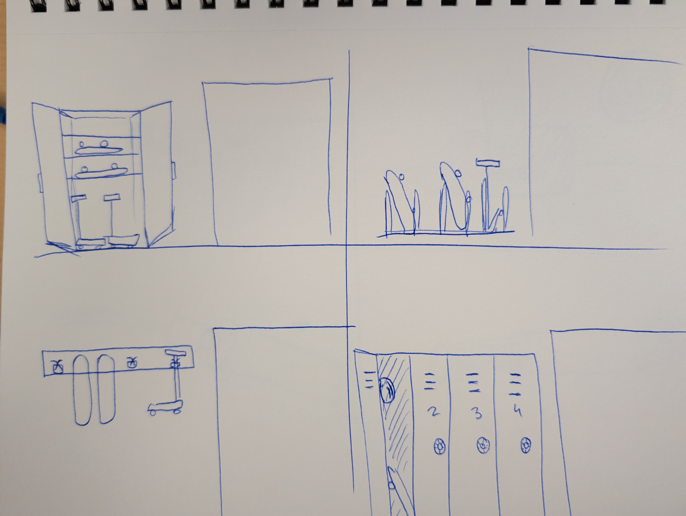
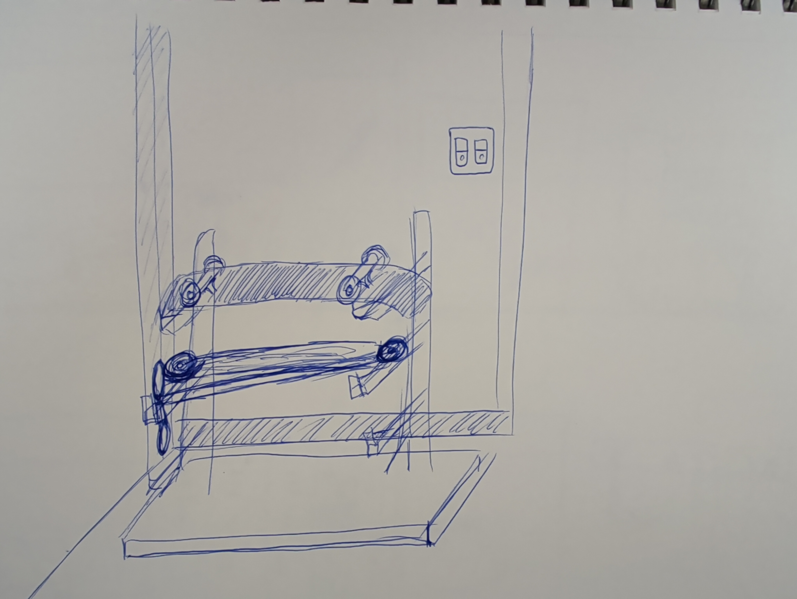
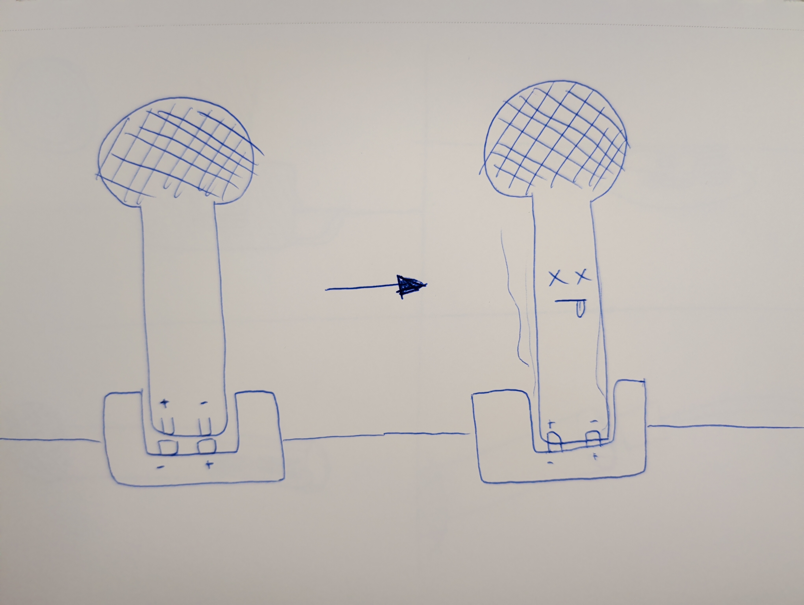

### False Affordance
The false affordance here is with this dongle device and how it is setup you would assume that you would be able to pull the cord and it would retract,
but the cord is stuck there.

Create two storyboards- one that documents the current interaction, and a second that imagines an improved interaction with as minimal an intervention as possible
With the original design of the Dell dock if you were to pull on the cable, even though it seems like more cable would pull out, you could end up just breaking the device.
So I redesigned it to do what it had appeared to, and be retractable

### Augmented Signifier
People kept leaning their skateboards and scooters on the wall, they did this enough times to warrant a sign

Create a visual rendering of an alternative design that would remove the need for the augmentation
To prevent people from setting their skateboards and scooters against the wall I have provided them a place to put them.

### Forcing Function
The bottom of the microphone is designed in such a way that forces the user to put it in the dock only one way

Imagine the scenario that requires the implementation of this design, and recount it as a visual narrative
The reason the microphone has the directional constraint on the charging circuit is to prevent someone from putting it in backwards.

