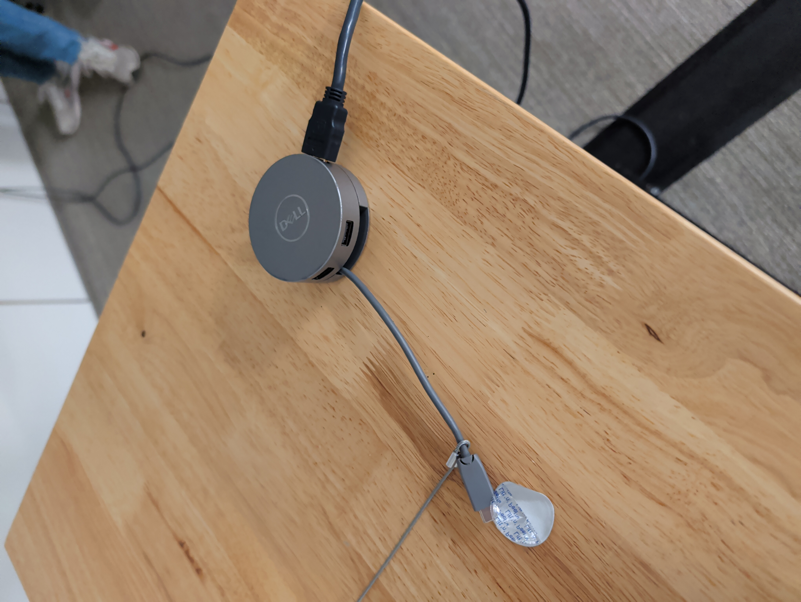
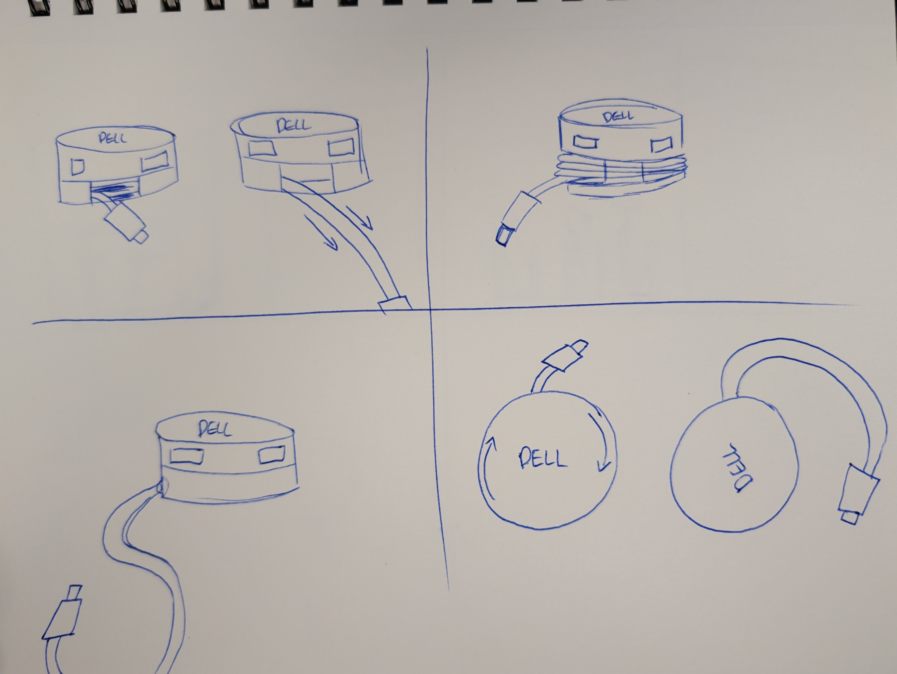
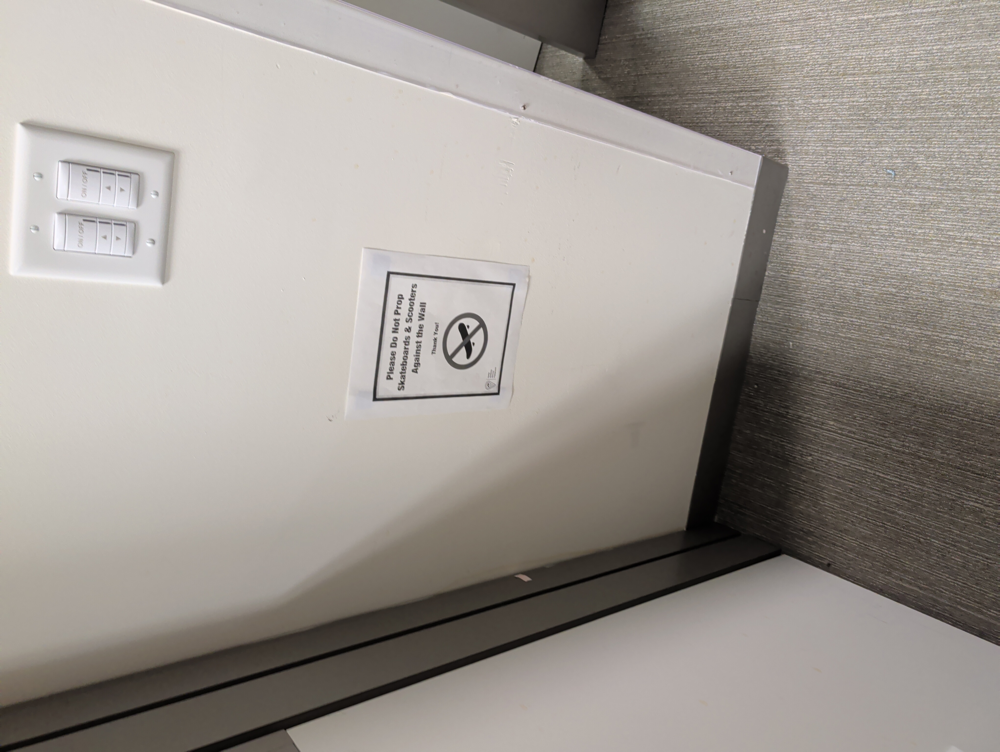
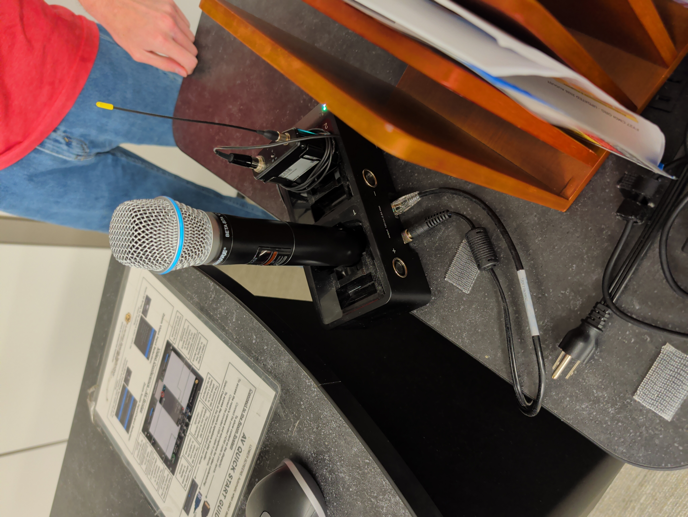
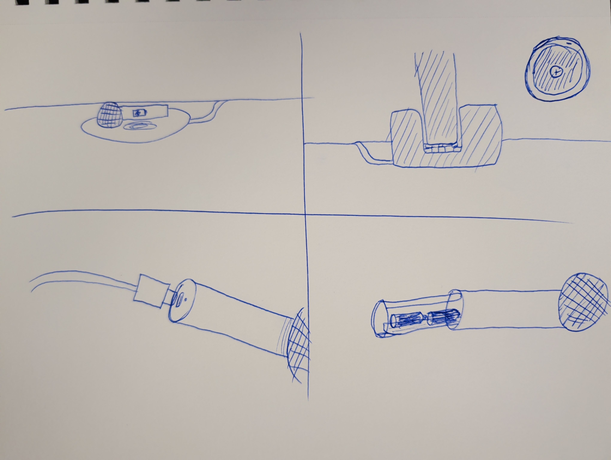

### False Affordance
The false affordance here is with this dongle device and how it is setup you would assume that you would be able to pull the cord and it would retract,
but the cord is stuck there.

### Augmented Signifier
People kept leaning their skateboards and scooters on the wall, they did this enough times to warrant a sign

### Forcing Function
The bottom of the microphone is designed in such a way that forces the user to put it in the dock only one way

